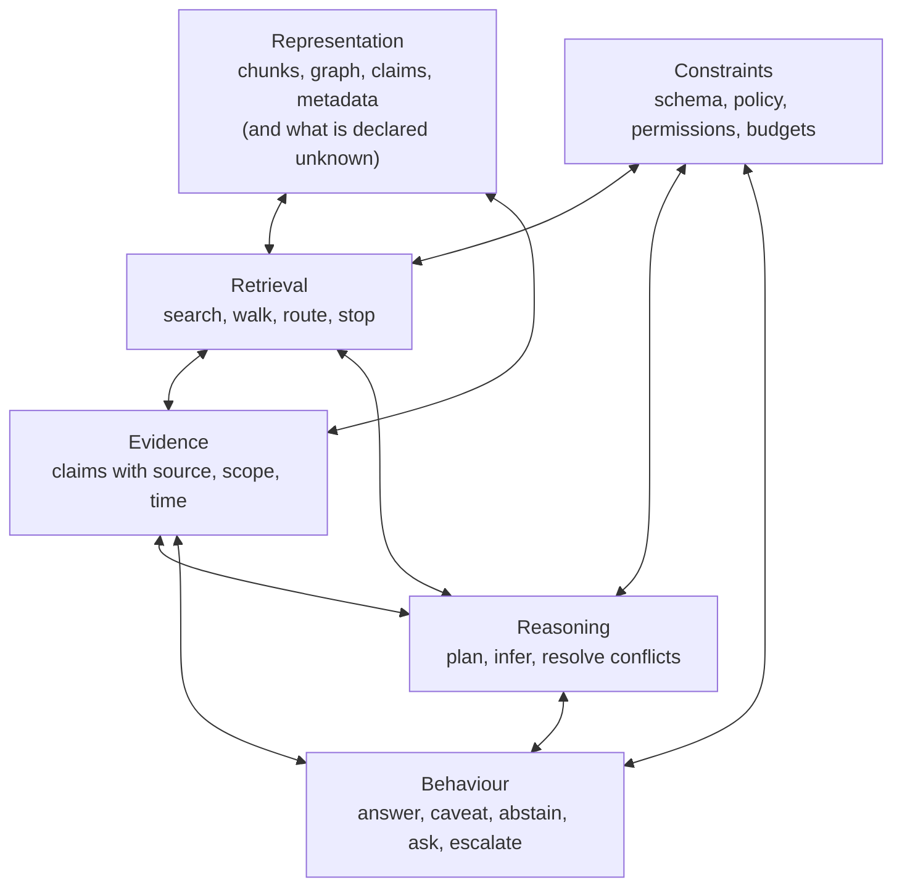

# Trust Is Not a Component

*Part 6 of 6 — The Edge Cases of Intelligent Knowledge Systems: Retrieval, Reasoning, and Trust in Enterprise AI*

---

## The dashboard that was green

Part 5 ended with the question this article tries to answer: if each part can fail on its own, what does it take for the whole to be trustworthy?

*Illustrative example (invented).* A team ships an internal assistant. Their evaluation looks thorough by common standards: a curated question set, an automated judge, strong answer accuracy. The dashboard is green. Some time later a senior engineer follows the assistant's advice on a decommissioning step and removes a dependency that other systems still used. The assistant's answer was fluent, cited, and — against the test set — typical. Postmortem: the service catalogue was missing those consumers (Part 2); an older document recommending the removal outranked an approved correction (Part 3); the agent's search ended after the first plausible result (Part 5); and nobody had asked the system to say what it could not establish.

Each failure belongs to a different part of the pipeline. None would have shown up as a drop in answer accuracy on the existing test set. That is the subject of this final article: trust is not a property of a component, and it is not captured by the metric most teams use.

## The assumption: trust is a score

Teams like to ask "how trustworthy is it?" and expect a number. The assumption underneath is that trustworthiness is a scalar that rises as components improve: better retriever, better model, better answer accuracy, more trust. The previous five articles show why that fails. Improving one part can *reduce* trust elsewhere — a more aggressive agent finds more evidence and also more ways to assemble an unsupported answer; a richer graph covers more questions and gives the missing edge more authority.

## A framework, not a formula

The proposal here is a conceptual one, and it is my own synthesis of the preceding five parts. The six components and nine dimensions below are not an established standard, have not been validated empirically, and could be carved up differently. They are offered as a way to organise the discussion. A knowledge system produces trustworthy behaviour when six components *interact* well, and trust shows up as properties along nine dimensions. The framework deliberately comes with no numeric score or formula.

*Alt text for the diagram:* six labelled boxes in a connected graph, not a stack: Representation, Retrieval, Evidence, Reasoning, Constraints and Behaviour. Two-way arrows join Representation to Retrieval and to Evidence; Retrieval to Evidence, Reasoning and Constraints; Evidence to Reasoning and to Behaviour; Reasoning to Constraints and to Behaviour; and Constraints to Behaviour. Representation has no direct link to Reasoning, Constraints or Behaviour.

The diagram is a map of interactions, not a stack, and its edges are illustrative: they mark interactions the earlier parts made worth discussing, not relationships derived from data or from the cited studies. Representation determines what can be retrieved, but retrieval failures reveal what the representation lacks. Retrieval and reasoning take turns: a reasoning step can trigger new retrieval, and a retrieved claim can invalidate a plan. Constraints limit which paths retrieval may take, what reasoning may conclude, and what behaviour is allowed. Behaviour is what the user sees, and a bad behaviour — a confident wrong answer — can originate in any component, or in the interaction of two. The order of the six articles is a reading order, not an architecture.

## The nine dimensions

| # | Dimension | The question it asks | Typical failure | Series part |
|---|---|---|---|---|
| 1 | **Retrieval effectiveness** | Is relevant material found? | Right document never surfaces | 1, 5 |
| 2 | **Completeness** | Does the store contain what the question needs, and does the system know where it doesn't? | Missing edge, silent gap | 2 |
| 3 | **Validity** | Is the retrieved claim currently true, in this scope, per the right authority? | Superseded runbook, wrong region | 3 |
| 4 | **Constraint adherence** | Does behaviour respect the constraints that apply: schema, policy, permissions, budgets? | Drift into irrelevant neighbourhoods; an answer that exposes material the asker may not see | 4, 5 |
| 5 | **Evidence grounding** | Is each statement supported by retrieved material? | Fluent claims from parametric memory | 2, 6 |
| 6 | **Source traceability** | Can a reader follow each claim to its origin and check it? | Citation that does not support the claim | 6 |
| 7 | **Uncertainty, calibration and escalation** | Does the system say what it cannot establish, express confidence that matches its reliability, and hand off to a person when it should? | Guess presented as fact; no route to a human | 2, 5 |
| 8 | **Efficiency** | Are tokens, latency and calls proportionate to the question, and how much do they vary from run to run? | Many steps for a lookup; cost that differs widely between runs | 1, 5 |
| 9 | **Maintainability** | Does quality survive change in data, schema and team? | Graph decays, schema drifts | 1, 4 |

Two distinctions are worth stating. *Grounding* asks whether a statement is supported by the retrieved material; *traceability* asks whether a reader can check that support by following the claim to its source. A system can be grounded without being traceable, if it gives no citations, and traceable without being valid (see below). Second, the reviewed studies cover only parts of dimensions 4 and 7: schema constraints (Part 4) and budgets (Part 5) for the first, abstention (Part 2) for the second. Permissions, policy, calibration and escalation are included because they matter in use, not because the work reviewed here measures them.

The components and dimensions are related, though not one-to-one. This is my mapping, and most dimensions have more than one source:

| Component | Primary dimensions | Also touches |
|---|---|---|
| Representation | 2 Completeness, 9 Maintainability | 5, 6 |
| Retrieval | 1 Retrieval effectiveness, 8 Efficiency | 2 |
| Evidence | 3 Validity, 6 Traceability | 5 |
| Reasoning | 5 Evidence grounding | 3, 4, 8 |
| Constraints | 4 Constraint adherence | 8, 9 |
| Behaviour | 7 Uncertainty, calibration and escalation | 5, 6 |

These are *dimensions*, not metrics to be summed. Some conflict (a stricter validity check costs efficiency; a more cautious abstention policy reduces apparent coverage). Some depend on each other (traceability is a precondition for checking grounding). Collapsing them into one score would hide exactly the trade-offs a team has to decide, and different uses place the thresholds differently: a casual lookup tool and an incident-response assistant should not share one.

## Why common RAG evaluation does not see this

The evaluation practices that dominate the literature leave most of the nine dimensions untouched. The evidence from earlier parts adds up:

- **Accuracy dominates; unanswerable questions are rare.** In the work reviewed here, dimension 7 is barely measured. GraphRAG-Bench has no unanswerable category; BRINK measures finding the answer, not declining; the conflict benchmark (Cattan et al.) has no abstention metric. The partial exceptions, Han et al.'s null-question category and HoH's "missing" class, score declining only inside a wider metric, and I found no measurement of calibration or escalation in these papers.
- **Cost is reported inconsistently.** The headline agentic result (AgenticRAG) reports tokens and tool calls but not latency or price. Dimension 8 appears as an afterthought.
- **LLM judges are imperfect instruments.** The foundational study of LLM-as-judge (Zheng et al., NeurIPS 2023) finds that strong judges can reach over 80% agreement with human preferences, similar to inter-human agreement, but shows position, verbosity and self-enhancement biases. Several papers in this series rely on an LLM judge, some without described human validation, and one (Han et al.) discusses position bias.
- **Public benchmarks can flatter systems.** BRINK's label experiment and the SCAIR authors' argument both suggest that recognisable names let models answer from memory. Dimensions 2 and 5 can look better than they are.
- **Short-term change is tested; long-term lifecycle rarely is.** Some work does evaluate temporally changing information: Re³'s benchmark includes recurring-update data such as weather forecasts, and HoH is built from Wikipedia revisions. What the benchmarks reviewed here do not do, as far as I could inspect, is follow a system through the long-term evolution of an organisation: schemas that are renamed or split, ownership that changes hands, processes that are retired, sources that are reorganised. Dimension 9 is therefore tested for fresh data, and seldom for lifecycle.
- **Attribution is checked less often than answers.** The ALCE benchmark (Gao et al., EMNLP 2023) is a rare exception: it evaluates citations, and its authors found that even the best models lacked complete citation support about half the time on one long-form dataset. That is a finding about models of 2023 on question answering over Wikipedia-style sources; it shows the dimension can be measured and that it is not automatically satisfied.

Broader surveys point the same way. A survey of trustworthiness in RAG (Zhou et al., arXiv 2409.10102, preprint) organises the topic along several axes and notes how fragmented the evaluation is. Surveys map; they do not validate.

## Interactions: why the whole differs from the parts

Three examples (all drawn from the preceding parts) of dimensions interacting:

1. **Retrieval × completeness.** Better retrieval over an incomplete store makes the wrong answer more convincing, not less. Improving dimension 1 without 2 can reduce trust.
2. **Validity × traceability.** A citation that points to a superseded document is *traceable* and *invalid*. Traceability without validity gives a well-referenced error.
3. **Agency × abstention × efficiency.** An agent with a budget must decide, when it runs out, between guessing and declining. The cost-minimising choice and the trust-maximising choice differ. Which prevails is a policy decision, not a technical one.

## What a profile looks like

*Illustrative example (invented).* The table compares the minimum acceptable behaviour for two uses of the same kind of system, on five of the nine dimensions. The entries are examples of how a team might write them down, not recommended thresholds.

| Dimension | Routine lookup tool (who owns this service?) | Incident-response assistant |
|---|---|---|
| Completeness | Answers from the register and says when a relation is not recorded exhaustively | Flags any relation not guaranteed complete in the affected area before advising an action, and never reads absence as "none" |
| Validity | Prefers the current owner record; a stale entry is tolerated if labelled with its last review | Separates approved procedure from recommendations, and shows unresolved disagreement before the engineer acts |
| Constraint adherence | Respects read permissions on the record | Respects permissions and stays inside the approved procedure's scope; never suggests a step that bypasses policy |
| Uncertainty, calibration and escalation | Says plainly that nothing was found | Declines to guess, and names a person to escalate to when evidence is insufficient or conflicting |
| Efficiency | Answers quickly with a short chain of steps | May spend more steps and time, within a declared budget and with a stated fallback when the budget runs out |

The two columns share a system but not a profile. A team that wrote only the left column would ship the incident assistant with a lookup tool's standards, which is the green dashboard of the opening.

## The strongest counterargument

*"This is a taxonomy. A taxonomy is not a method. Practitioners need a scorecard they can track and a threshold that says ship or don't ship. Nine unquantified dimensions are an invitation to endless discussion, and 'it depends' is not a release criterion."*

It is a legitimate complaint. A framework with no operational content would be decoration. The response has three parts. First, a composite number is worse than none when its weights hide a trade-off: a team that sums nine dimensions will find the sum improved by raising the easy ones. Second, "no score" does not mean "no measurement". Each dimension can be probed with its own test: ablated knowledge for completeness, supersession pairs for validity, constraint traps (schema, permission and budget violations) for constraint adherence, unanswerable questions for abstention, step and token counts across repeated runs for efficiency and variance. Third, release criteria can be per-dimension minimums set by use, rather than one pooled score, as in the profiles above. The framework asks teams to write the profile down; it does not tell them where to set it.

A second objection deserves mention: *"Trust is partly in the user's head. A system can satisfy all nine and still be distrusted, or lack all nine and be trusted."* That is true and outside the scope here. The claim is only that *warranted* trust requires these properties — a system should be trusted to the degree it is trustworthy.

## Design implications

Treat the following as engineering suggestions, not tested results.

1. **Write a trust profile, not a score.** For each of the nine dimensions, state what the system does, how it is tested, and the minimum acceptable behaviour for the intended use. Review it when the system or the data changes.
2. **Test dimensions with purpose-built probes.** Maintain small, versioned sets: unanswerable questions, supersession pairs, ablated facts, constraint traps, and cost budgets.
3. **Evaluate with human checks where judges decide.** Validate any LLM judge against human labels on a sample, and report agreement.
4. **Make behaviour a first-class output.** Let the system answer, caveat, ask a clarifying question, escalate or decline — and test each choice.
5. **Trace failures to components.** When a bad answer happens, classify the origin: representation, retrieval, evidence, reasoning, constraint or behaviour. Over time, the distribution of causes shows where investment pays.
6. **Plan for change.** Assign owners for the schema, the sources, and the evaluation sets. Trust decays when nobody owns it.

## Open questions

- Can the dimensions be made operational enough to compare systems without collapsing into a single number?
- How should abstention be scored — what is the cost of a wrong answer versus a refusal, and who decides?
- What is the right unit for evaluating *behaviour over time*, as sources and schemas change?
- Do human users change how they check answers when a system shows its evidence and its doubts — and does that increase *warranted* trust?

## Conclusion

The series began with a team deciding between graph and vector, and it has ended with a profile instead of a decision, which is the point. A knowledge system for an organisation is trustworthy to the degree it knows the shape of what it holds, says what it cannot establish and when to hand off, tracks which claims apply and which have been replaced, moves through structure with constraints, spends effort in proportion to the question, and lets a reader check its work. None of those lives in one component. Most are not yet well measured. Naming them is the first step toward building systems that deserve the trust people will, in any case, place in them.

---

> **Key takeaways**
> - Trust is neither a score nor a component: it shows up as properties along nine dimensions that interact and sometimes conflict, so improving one can reduce another.
> - In the work reviewed, common RAG evaluation barely measures uncertainty and abstention, cost beyond tokens, long-term change, or checkable attribution.
> - Write a trust profile for each use, with minimum acceptable behaviour per dimension, and test each dimension with its own probe.

**Reading notes.** The six components, nine dimensions and the component-to-dimension mapping are the author's own synthesis and have not been validated. *Zheng et al. (LLM-as-judge), ALCE, Zhou et al. (survey), Wen et al. (survey):* abstract or record level; the 80% agreement figure is the judge paper's own claim. *BRINK, SCAIR, GraphRAG-Bench, Han et al., DRAGged, HoH, Re³, AgenticRAG:* used here only for the points stated; their reading depth is given in Parts 1 to 5.

## References

- Gao, T., Yen, H., Yu, J., Chen, D. (2023). Enabling Large Language Models to Generate Text with Citations (ALCE). *Proceedings of EMNLP 2023*, pp. 6465–6488; arXiv:2305.14627.
- Zheng, L., Chiang, W.-L., Sheng, Y., Zhuang, S., Wu, Z., Zhuang, Y., Lin, Z., Li, Z., Li, D., Xing, E. P., Zhang, H., Gonzalez, J. E., Stoica, I. (2023). Judging LLM-as-a-Judge with MT-Bench and Chatbot Arena. *NeurIPS 2023*; arXiv:2306.05685.
- Zhou, Y., Zhang, W., Shao, J., Liu, Y., Li, X., Jin, J., Qian, H., Liu, Z., Li, C., Zhang, J. C., Dou, Z., Yu, P. S., Mao, J. (2024). *Trustworthiness in Retrieval-Augmented Generation Systems: A Survey.* arXiv:2409.10102 (v1 Sep 2024; v2 May 2026). **Preprint;** no venue stated.
- Wen, B., Yao, J., Feng, S., Xu, C., Tsvetkov, Y., Howe, B., Wang, L. L. (2025). Know Your Limits: A Survey of Abstention in Large Language Models. *Transactions of the ACL* 13, 529–556. DOI: [10.1162/tacl_a_00754](https://doi.org/10.1162/tacl_a_00754).
- Zhou, D., Zhu, Y., Wang, X., Zhou, H., He, Y., Chen, J., Staab, S., Kharlamov, E. (2026). What Breaks Knowledge Graph based RAG? Benchmarking and Empirical Insights into Reasoning under Incomplete Knowledge (BRINK). *Proceedings of EACL 2026 (long papers)*, pp. 2522–2538. DOI: [10.18653/v1/2026.eacl-long.114](https://doi.org/10.18653/v1/2026.eacl-long.114). arXiv:2508.08344 v4.
- Chaturvedi, P., Zhu, Y., Zhou, H., Zhou, D., He, Y., Staab, S., Du, F., Tang, J., Kharlamov, E. (2026). SCAIR: Schema-Conditioned Agentic Iterative Reasoning for Enterprise Knowledge Graphs. *Proceedings of ACL 2026 (Industry Track)*, pp. 1089–1104. DOI: [10.18653/v1/2026.acl-industry.76](https://doi.org/10.18653/v1/2026.acl-industry.76).
- Xiang, Z., Wu, C., Zhang, Q., Chen, S., Hong, Z., Huang, X., Su, J. (2026). *When to use Graphs in RAG: A Comprehensive Analysis for Graph Retrieval-Augmented Generation* (GraphRAG-Bench). ICLR 2026 (poster); arXiv:2506.05690 (v3, Feb 2026).
- Han, H., Ma, L., Wang, Y., Shomer, H., Lei, Y., Qi, Z., Guo, K., Hua, Z., Long, B., Liu, H., Aggarwal, C. C., Tang, J. (2025). *RAG vs. GraphRAG: A Systematic Evaluation and Key Insights.* arXiv:2502.11371 (v1 Feb 2025; v3 Mar 2026). **Preprint;** no venue stated on the arXiv page.
- Cattan, A., Jacovi, A., Ram, O., Herzig, J., Aharoni, R., Goldshtein, S., Ofek, E., Szpektor, I., Caciularu, A. (2025). *DRAGged into Conflicts: Detecting and Addressing Conflicting Sources in Search-Augmented LLMs.* arXiv:2506.08500 (v2, Jun 2025). **Preprint;** no venue stated on the arXiv page.
- Ouyang, J., Pan, T., Cheng, M., Yan, R., Luo, Y., Lin, J., Liu, Q. (2025). HoH: A Dynamic Benchmark for Evaluating the Impact of Outdated Information on Retrieval-Augmented Generation. *Proceedings of ACL 2025 (long)*, pp. 6036–6063. DOI: [10.18653/v1/2025.acl-long.301](https://doi.org/10.18653/v1/2025.acl-long.301).
- Cao, J., Ouyang, J., Cheng, M., Zhou, Z., Liu, C., Li, Y., Liu, Z., Wang, S. (2026). Re3: Relevance & Recency Retrieval for Mitigating Temporal Hallucination. *Proceedings of ACL 2026 (long)*, pp. 25735–25760. DOI: [10.18653/v1/2026.acl-long.1180](https://doi.org/10.18653/v1/2026.acl-long.1180).
- Suresh, S., Mak, H., Chou, S., Kroon, F., Bhatnagar, S. (2026). *AgenticRAG: Agentic Retrieval for Enterprise Knowledge Bases.* arXiv:2605.05538 (v1, 7 May 2026). **Preprint; no code.**
